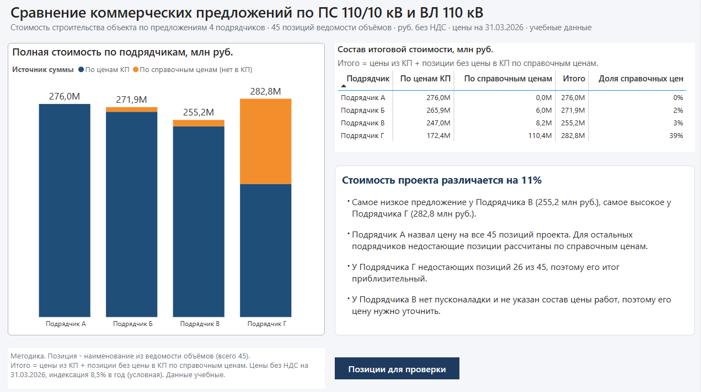
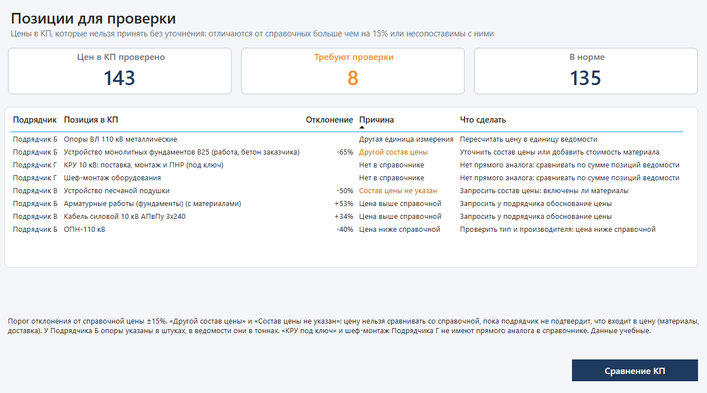
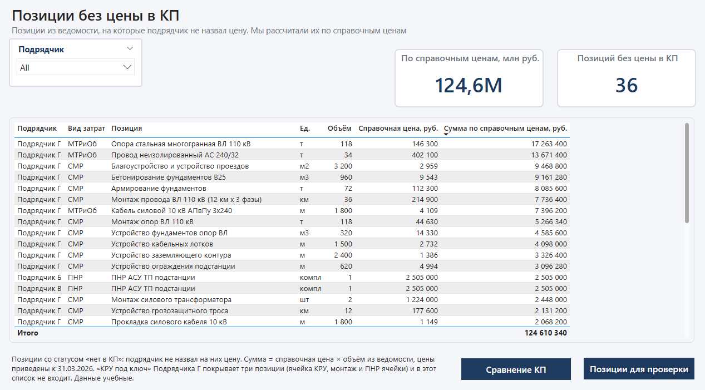

# Автоматизация коммерческого анализа и сопоставления тендерных предложений в строительстве

Сквозное аналитическое решение: четыре альтернативных коммерческих предложения (КП) на строительство
подстанции 110/10 кВ и воздушной линии 110 кВ приводятся к единым условиям и сопоставляются со справочником расценок.

**Инструменты:** Python (генерация данных), Power Query (очистка и приведение), Power BI (дашборд).

> **Примечание.** Все данные в проекте условные. Подрядчики вымышлены, цены, нормативы и справочник
> смоделированы для демонстрации методологии и не отражают реальный рынок.

## Бизнес-задача

КП от разных подрядчиков нельзя сравнивать «как есть»: у одних цены указаны с НДС, у других без, где-то в тысячах рублей;
различаются единицы измерения; названия позиций не совпадают; часть позиций пропущена, а состав цены
(включены ли материалы в стоимость работ) указан по-разному.

Проект решает три задачи:

1. **Корректная полная стоимость.** Расчёт стоимости полного объёма работ у каждого подрядчика при одинаковых условиях.
2. **Выявление отклонений цен.** Поиск цен, которые заметно выше или ниже справочных, и тех, которые нельзя сравнивать
   (другой состав цены, другая единица измерения), с рекомендацией, что уточнить у подрядчика.
3. **Недостающие позиции.** Определение позиций, на которые подрядчик не назвал цену, и расчёт их стоимости по справочным ценам.

## Технологический стек и реализация

- **Python** — генерация условных данных (ведомость объёмов, КП четырёх подрядчиков, справочник, история договоров)
  с заложенными типовыми ошибками для проверки модели.
- **Power Query** — ETL-логика: чтение разнородных файлов, очистка, нормализация (НДС, единицы цены, индексация цен
  к единой дате, сопоставление названий) и приведение КП к единому формату.
- **Power BI** — интерактивный дашборд из трёх страниц: сравнение итоговой стоимости, список цен для проверки,
  позиции без цены в КП.

## Результаты

Млн руб. без НДС, цены приведены к 31.03.2026.

| Подрядчик   | По ценам КП | По справочным ценам | Итого | Позиций с ценой в КП |
| ----------- | ----------: | ------------------: | ----: | -------------------: |
| Подрядчик А |       276,0 |                 0,0 | 276,0 |             45 из 45 |
| Подрядчик Б |       265,9 |                 6,0 | 271,9 |             42 из 45 |
| Подрядчик В |       247,0 |                 8,2 | 255,2 |             38 из 45 |
| Подрядчик Г |       172,4 |               110,4 | 282,8 |             19 из 45 |

У Подрядчика Г строка «КРУ под ключ» покрывает три позиции ведомости (КРУ, его монтаж и ПНР), поэтому в расчёте у него
19 позиций с ценой.

- Разница между самым низким (Подрядчик В, 255,2 млн руб.) и самым высоким (Подрядчик Г, 282,8 млн руб.) итогом
  составляет 27,6 млн руб., или около 11% от самого низкого. Надёжность цифр разная: у Подрядчика Г 39% итога
  это расчёт по справочным ценам, а не цена подрядчика.
- 8 цен требуют проверки: завышение и занижение относительно справочника, другой состав цены, другая единица
  измерения, отсутствие аналога в справочнике.
- 36 позиций ведомости не получили цену в КП (Б: 3, В: 7, Г: 26).

## Страницы дашборда

| Сравнение КП                          | Позиции для проверки              | Позиции без цены в КП              |
| ------------------------------------- | --------------------------------- | ---------------------------------- |
|  |  |  |

PDF-версия: `report/kp_expertise.pdf`.

## Как устроен расчёт

Подробно: [docs/methodology.md](docs/methodology.md). Коротко:

1. Каждое КП читается из своего файла (разная структура, заголовки, листы).
2. Цены приводятся к рублям без НДС (22% и 20%), тысячи рублей пересчитываются.
3. Названия позиций сопоставляются с ведомостью через таблицу соответствий (`data/source/name_mapping.xlsx`).
4. Цены индексируются к 31.03.2026 (условный рост 8,5% в год).
5. Цена сравнивается со справочной; отклонение больше 15% или несопоставимый состав/единица дают флаг.
6. Позиции без цены в КП достраиваются по справочным ценам, чтобы итоги были сопоставимы.

## Проверка модели на заложенных ошибках

Чтобы проверить, находит ли модель типичные проблемы реальных КП, в данные намеренно заложены ошибки.
Полный перечень (20 записей) лежит в `tests/injected_anomalies.csv`: для каждой указаны файл, позиция,
описание и ожидаемый вывод экспертизы.

Типы заложенных ошибок:

- **Формат и размерность:** НДС в цене, цены в тысячах рублей, устаревшее КП.
- **Номенклатура:** разные формулировки названий, разные единицы измерения (опоры в штуках вместо тонн).
- **Структура затрат:** разный состав цены («работа» и «работа с материалом»), пакетная позиция «под ключ» без разбивки.
- **Полнота и цены:** пропущенные позиции, завышение и занижение цен относительно справочника.

Результат проверки:

- Ошибки формата, размерности и формулировок исправляются при приведении данных (Power Query).
- На дашборде выводятся 8 цен для проверки и 36 пропущенных позиций с расчётом стоимости по справочнику.
- Частично обработаны две ошибки: доставка в цене Подрядчика Г только помечается и не вычитается, выброс в истории
  договоров не проверяется, так как история пока не входит в расчёт (см. «Ограничения модели»).

## Структура репозитория

```text
scripts/generate_data.py     генератор данных на Python
data/source/                 исходные файлы: ведомость объёмов, КП А/Б/В/Г, справочник цен,
                             таблица соответствий названий, история договоров, аналоги, нормы,
                             условный предельный норматив
tests/injected_anomalies.csv журнал заложенных ошибок
report/                      модель Power BI (.pbix) и экспорт в PDF
powerbi/                     тексты запросов Power Query (queries.pq) и мер (measures.dax)
images/                      скриншоты страниц дашборда
docs/methodology.md          методика расчёта и приведения данных
```

## Как воспроизвести

1. Данные: `pip install openpyxl`, затем `python scripts/generate_data.py`
   (результат детерминирован, создаются все 11 файлов в `data/source/`).
2. Отчёт: откройте `report/kp_expertise.pbix` в Power BI Desktop (Windows), в **Transform data → Manage parameters**
   укажите в параметре `pFolder` путь к папке `data/source/` (со слэшем в конце) и нажмите **Home → Refresh**.
   Тексты запросов и мер для чтения без Power BI находятся в папке `powerbi/`.

## Ограничения модели

- **Справочник условный и статичный.** Файлы `contracts_history.xlsx`, `analog_objects.xlsx`, `resource_norms.xlsx`
  и `limit_conditional.xlsx` сгенерированы «на вырост», но в расчёт пока не входят.
- **Индексация условная.** Применена ставка 8,5% в год. В рабочем решении используются официальные индексы
  изменения стоимости строительства.
- **Доставка в цене Подрядчика Г.** Размер доставки в КП не выделен, поэтому цена не корректируется.
  В данных КП отмечено признаком `ДоставкаВключена`, на дашборде он не выводится.
- **Пакетные позиции.** Итоги Подрядчика Г по видам затрат сравнивать нельзя: позиция «КРУ под ключ» (поставка,
  монтаж, ПНР) зафиксирована одной суммой в блоке МТРиОб.
- **Пропущенные позиции.** Стоимость позиций, на которые подрядчик не назвал цену, рассчитана по справочнику.
  Дашборд показывает эти позиции, но они требуют официального запроса цены у подрядчика.

## Дальнейшее развитие

- Динамический пересчёт справочника по истории договоров.
- Проверка по объектам-аналогам и предельным нормативам.
- Переход к ресурсному методу оценки.
- Вывод признака «доставка в цене» на дашборд.
